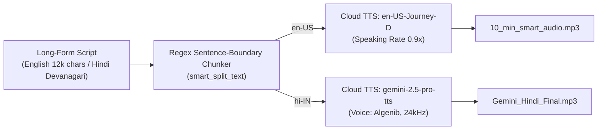

# 🔊 Long-Form Multilingual Neural TTS (`longform-multilingual-tts`)


_%7C_Hindi_(hi--IN)-10B981?style=for-the-badge)


Production utilities for synthesizing **long-form (10+ minute, 12,000+ character)** English documentary narration (`en-US-Journey-D`) and expressive Hindi storytelling (`hi-IN`, `gemini-2.5-pro-tts` / `Algenib`) while bypassing the 5,000-byte per-request API limit via regex sentence-boundary chunking and binary MP3 stream concatenation.

---

## 📐 Architecture



---

## 📁 Project Structure

```text
longform-multilingual-tts/
├── main.py                     # Unified CLI entry point (--mode english | hindi | all)
├── feature_long_audio_tts.py   # 10-minute English documentary script, chunker, and Journey-D synthesis
├── feature_story_gen.py        # Hindi Devanagari story script, chunker, and gemini-2.5-pro-tts synthesis
├── tts_test.py                 # Standalone runner for English documentary synthesis
├── 10_min_smart_audio.mp3      # Sample synthesized 10-minute English documentary MP3
├── Gemini_Hindi_Final.mp3      # Sample synthesized Hindi story MP3
├── requirements.txt            # Python dependencies
└── README.md                   # Project documentation
```

---

## 🚀 Quickstart

```bash
git clone https://github.com/shubhamv3129/longform-multilingual-tts.git
   cd longform-multilingual-tts
python3 -m venv .venv
source .venv/bin/activate
pip install -r requirements.txt

gcloud auth application-default login

# Run both English and Hindi synthesis pipelines:
python3 main.py --mode all
```
